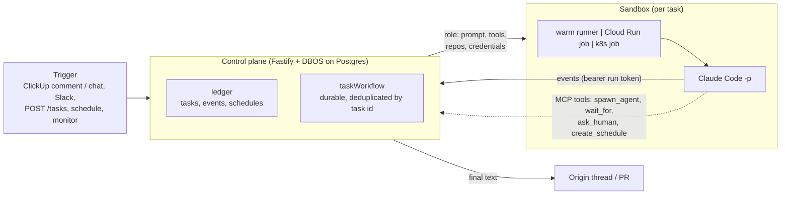

# ai-employee

An AI developer you deploy on your own cloud. A control plane takes tasks from ClickUp, Slack, HTTP,
schedules and monitors, and runs [Claude Code](https://docs.claude.com/en/docs/claude-code) headless in an
isolated sandbox for each task. What the agent may do (prompt, tools, repos, credentials) comes from a YAML
file in git, not from model judgment. Roles can be chained into multi-stage workstreams, a manager role can work a
backlog task by task, and background monitors can raise work when something breaks. Results go back to the
ClickUp task, chat channel or Slack thread the request came from. The control plane never runs agent code itself.

Status: single-tenant, one control plane per deployment, built for a small team. Read
[Current limitations](#current-limitations) before you expose it to the internet.

## What it is for

| You want | How it runs here |
|---|---|
| **Bug triage, spec, PR.** Comment `!dev` on a ClickUp task and get a researched ticket, a spec you approve, a pull request and a review. | The default role (`developer`, the "foreman") delegates to `triage`, `spec`, `implement` and `review` roles with `spawn_agent`, waits on each, and pauses with `ask_human` when it needs your decision. It never merges. |
| **Nightly or weekly jobs.** "Every weekday at 07:00, list stale PRs in these repos and post a summary here." | Ask the employee in chat. It calls `create_schedule`; the control plane stores a cron schedule and starts a task at each fire time. |
| **Error monitoring that opens fixes.** Watch Application Insights exceptions and ClickUp support channels. | A monitor runs a plain collector every few minutes with no model cost. Only a new or spiking error starts a cheap `monitor-triage` task, which says `NOISE` (nothing is posted), posts an alert, or hands the finding to `developer` or `compound` to open a PR. |
| **A backlog worked one task at a time.** | Tasks started with `managedBy` wake a `manager` role when they finish. The manager reads the backlog, checks the repo for what is really done, and dispatches what is unblocked. |
| **Ad hoc help.** "What does this module do?" "Why did the deploy fail?" | The same employee answers directly, read-only, in the thread where you asked. |

## How it works



1. **Trigger.** Every trigger becomes a task with an id (`clickup:<task>:comment:<id>`, `slack:...`, `http:<employee>:<key>`,
   `cron:...`, `monitor:...`). The id is the dedup key: the same trigger cannot start twice.
2. **Workflow.** `taskWorkflow` (`apps/control-plane/src/orchestration/workflow.ts`) runs these steps: acknowledge,
   build the run spec, launch the sandbox, wait, collect the result, post it, record it in the ledger. DBOS keeps it durable
   across restarts.
3. **Role.** The task names a role of an employee. The control plane turns the role into a run: the system prompt (plus a
   generated "your environment" footer), the tool allowlist, MCP servers, repos to clone, and the credentials the role is granted.
4. **Sandbox.** The run goes to a runtime: the always-on warm runner, a Cloud Run job execution, a Kubernetes Job, or a
   local process. The runner clones the repos, logs in the tools, and starts `claude -p`. Anything not in the allowlist is denied, not prompted.
5. **Results.** The runner pushes normalized events to the control plane. The final text is posted back to where the
   request came from (ClickUp comment or chat message, Slack thread). Failed cron, child and HTTP-triggered runs also post an alert to `ALERT_CHANNEL_ID` when it is set.
6. **Delegation.** A role with the `agents` capability gets MCP tools to start child tasks (each in its own sandbox), watch
   them, cancel them and ask a human. A child is an ordinary task with a parent. Depth is capped at 2 and active children at 4 per task.

## Key concepts

| Term | Meaning | Defined in |
|---|---|---|
| **Employee** | One durable identity: an id, a name, a set of roles, workstreams and monitors. Has one task ledger. | one YAML file in `ROLES_DIR` |
| **Role** | What one run may do: prompt, tools, MCP servers, repos, credentials, runtime, limits. Chosen by lookup, never by the model. | `roles:` in the employee YAML |
| **Prompt** | A role's system prompt, inline (`systemPrompt`) or from a markdown file (`systemPromptFile`). Appended to Claude Code's own prompt. | YAML + `roles/prompts/*.md` |
| **Workstream** | A named entry point to a multi-stage flow (`start_workstream("sdlc", brief)`). It resolves to one starting role, which delegates to the rest. | `workstreams:` |
| **Monitor** | A deterministic collector that runs every N minutes and starts a triage task only on something new. Off by default. | `monitors:` (definition), database (on/off) |
| **Schedule** | A cron job that starts a task for a role. Created at run time by an agent, stored in Postgres. | `schedules` table; `create_schedule` tool |
| **Manager / backlog** | A role woken (debounced) when tasks it dispatched finish, plus a heartbeat. Enabled by `MANAGER_ROLE`. | env + a `capabilities: [backlog]` role |
| **Credentials / grants** | Named grants (`github`, `clickup`, `claude-subscription`, ...) that decide which secrets from the control plane's env a run receives. | `credentials:` + env vars |
| **Sandbox runtime** | Where a run executes: `warm`, `cloudrun`, `k8s`, `local`. A deployment picks a default; a role can opt into `cloudrun`. | `SANDBOX_RUNTIME`, role `runtime:` |

Full field reference: [docs/configuration.md](docs/configuration.md).

## Quickstart (local)

Runs the control plane and one runner as plain processes on your machine, with Postgres in Docker. You need Node 22+,
pnpm, Docker, and the `claude` CLI on your `PATH` (`npm i -g @anthropic-ai/claude-code`), plus an Anthropic API key
or a `claude setup-token` token.

```sh
make dev                       # Postgres on :5432 with databases ai_employee and ai_employee_dbos
pnpm install && pnpm -r build
cp .env.example .env           # set ANTHROPIC_API_KEY (or CLAUDE_CODE_OAUTH_TOKEN); leave the rest
set -a; . ./.env; set +a       # the control plane does not read .env itself
pnpm --filter @ai-employee/control-plane start
```

The control plane applies its SQL migrations on boot. `pnpm --filter @ai-employee/control-plane dev` does the same under `tsx watch`.

Send a task. Use the `assistant` role: the default role (`developer`) clones placeholder repos and expects the agent MCP
server, which this local setup does not provide.

```sh
curl -s localhost:3000/tasks -H 'content-type: application/json' \
  -d '{"employeeId":"dev","roleId":"assistant","prompt":"List the files in your working directory and summarise them.","taskKey":"demo1"}'
curl -s localhost:3000/tasks/http:dev:demo1          # status, result
curl -s localhost:3000/tasks/http:dev:demo1/events   # what the agent did
```

Send the same `taskKey` again and you get `200 {"started":false}`. That is the dedup guarantee. Open
`http://localhost:3000/status` for a live view.

Notes:

- The control plane does not pass a workspace path to local runners, and the runner defaults to `/workspace`, which usually
  cannot be created (macOS root is read-only). `LOCAL_RUNNER_CMD` in `.env.example` sets `WORKSPACE_DIR` through `env`. Without it the
  task fails with `ENOENT: mkdir '/workspace'`.
- `apps/control-plane/roles/dev.yaml` is an example employee with placeholder repos (`your-org/...`) and placeholder Azure and ClickUp
  ids. Edit it before using the `developer` and workstream roles; see [docs/configuration.md](docs/configuration.md).
- Kubernetes on a laptop: `make kind`, build and `kind load` the runner image, then run the control plane with
  `SANDBOX_RUNTIME=k8s` and `PUBLIC_BASE_URL=http://host.docker.internal:3000`.

To deploy for real (always-on VM with HTTPS, Cloud Run jobs, Kubernetes), see [docs/deploy.md](docs/deploy.md).

## Triggers

| channel | how | task id (dedup key) |
|---|---|---|
| ClickUp task comment | comment containing `!dev` (`CLICKUP_TRIGGER_WORD`; default is `!<DEFAULT_EMPLOYEE_ID>`) | `clickup:<task>:comment:<comment id>` |
| ClickUp task assigned to the bot | needs `CLICKUP_BOT_USER_ID` | `clickup:<task>:assigned:<history id>` |
| ClickUp Chat channel | Chat Automation "Message is posted" then "Call webhook" to `/clickup/chat` with header `X-Bot-Secret` | `clickup-chat:<channel>:<message id>` |
| Slack mention or message | Events API to `/slack/events` | `slack:<team>:<channel>:<ts>` |
| HTTP | `POST /tasks` (optional `taskKey`, `roleId`, `managedBy`) | `http:<employee>:<key>` |
| Schedule | created by an agent; fires from the 1-minute tick | `cron:<schedule id>:<fire time>` |
| Monitor | collector found something new | `monitor:<employee>:<name>:<minute>` |
| Manager wake | backlog work finished, or heartbeat | `manager:<employee>:<minute>` |

Slack and ClickUp traffic goes to `DEFAULT_EMPLOYEE_ID`'s default role. Other employees are reachable through `POST /tasks`,
schedules and monitors. Bot replies start with the robot emoji and are ignored on the way back in, so the bot cannot trigger itself.

## Layout

| path | what |
|---|---|
| `packages/core` | the two adapter boundaries (`Orchestrator`, `SandboxRuntime`), `RunnerEvent`, and the `Role` / `Employee` schemas |
| `packages/adapters` | sandbox runtimes: warm runner, Cloud Run job, Kubernetes Job, local process |
| `apps/control-plane` | HTTP server (triggers, event sink, agent API), DBOS workflow and steps, ledger SQL, monitors, role loader |
| `apps/control-plane/roles` | the example employee (`dev.yaml`) and its prompts |
| `apps/runner` | the sandbox image: repo clone, tool logins, `claude -p`, event push, the `ai-employee-tools` MCP server |
| `infra/` | `local`, `gcp-vm`, `gcp-cloudrun`, `gcp` + `k8s`, `azbroker` |
| `docs/` | [configuration](docs/configuration.md), [deploy](docs/deploy.md), [architecture decisions](docs/architecture.md) |

## Tests

```sh
pnpm -r test                                                                # unit + DBOS end-to-end (needs `make dev`)
cd packages/adapters && K8S_INT=1 pnpm vitest run src/k8s-job.int.test.ts   # needs `make kind`
node scripts/leak-check.mjs                                                 # public-repo leak guard
```

## Security

This is an agent that can write code and use your tokens. Treat the deployment accordingly.

- **Most HTTP routes have no authentication.** `POST /tasks`, `GET /tasks/:id`, `/tasks/:id/events`, `POST /tasks/:id/cancel`,
  `/employees/:id/*`, `/stats`, `/runtime`, `/status` and `/runs/:id/view` are open to anyone who can reach the port. Anyone who can
  call `POST /tasks` can make your employee run a prompt with your credentials. Put the control plane behind an IP allowlist, a VPN or
  an authenticating proxy before exposing it, and allow only the webhook paths you use from the internet. Details and the full route
  table: [docs/deploy.md#security](docs/deploy.md#security).
- Webhooks are verified (Slack and ClickUp HMAC signatures, a shared secret for ClickUp Chat). Agent routes need a per-run bearer
  token that is valid only for that task and expires after the role's timeout plus ten minutes.
- Role credentials are static secrets in the control plane's environment, injected into the sandbox per run. Grant the least a role needs.
- Never commit `.env`, Terraform state or `*.tfvars`. `scripts/leak-check.mjs` and the CI workflow guard this repository.

## Current limitations

- No API authentication on the operator routes (above).
- Role and employee YAML is read once at boot and, in the shipped images, baked into the control-plane image. Changing a role means
  rebuilding the image (or mounting your own roles directory) and restarting. See [docs/configuration.md](docs/configuration.md#what-to-redeploy).
- Schedules are created by agents at run time, not declared in YAML. Monitor on/off state lives in the database.
- One control plane process per database (DBOS runs as a single executor). Cloud Run `max_instance_count` is pinned to 1 for that reason.
- Credentials are static tokens from the environment; short-lived minted tokens are not implemented.
- The Slack and ClickUp routes serve only `DEFAULT_EMPLOYEE_ID`.
